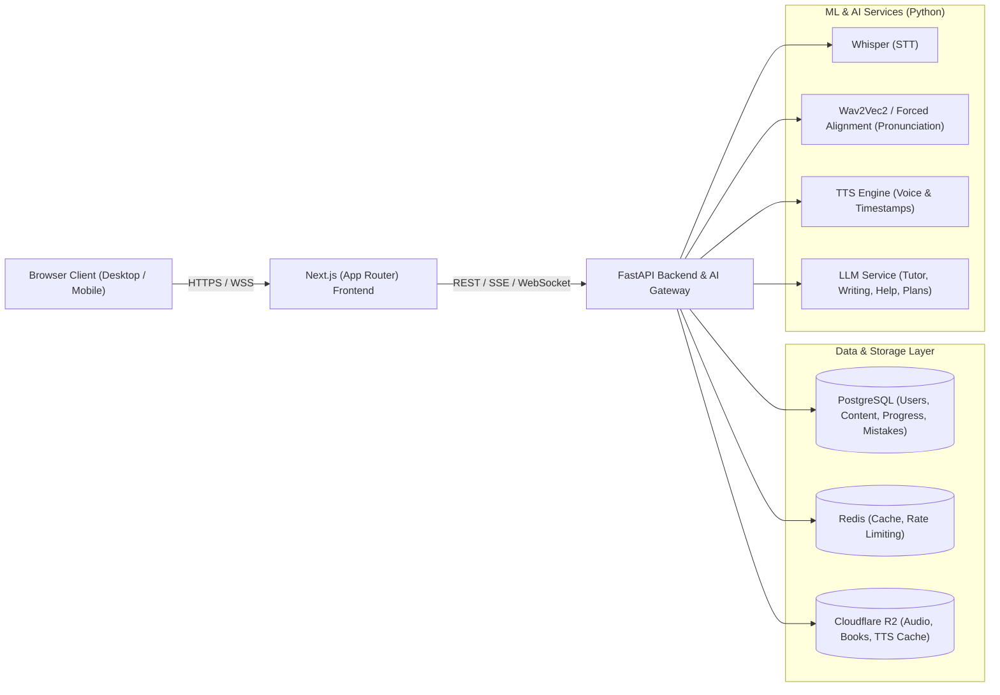
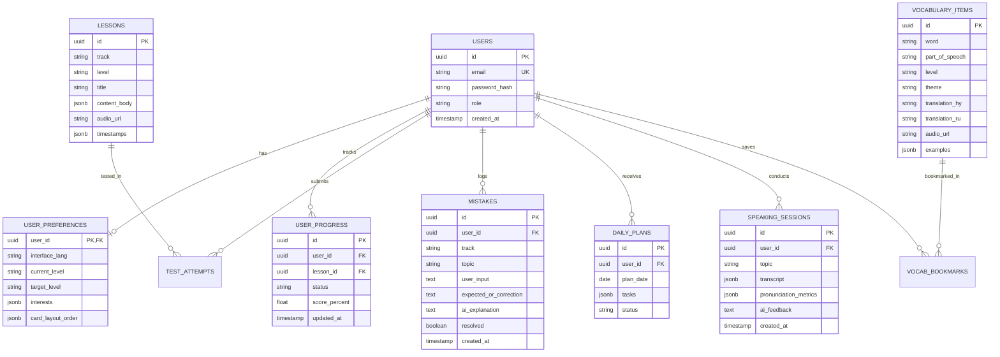
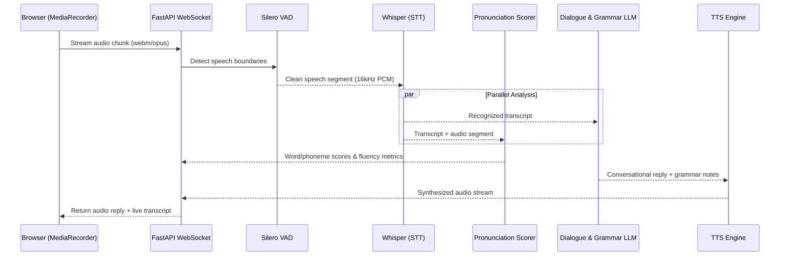

# Technical Architecture & Design Document
## "Learn English with AI" System

- **Document Version:** 1.0
- **Related Document:** [FRD.md](./FRD.md) (v1.1)
- **Architecture Style:** Decoupled Full-Stack Web Application (`Next.js App Router` + `FastAPI`)

---

## 1. Architecture Overview & Stack Rationale

The "Learn English with AI" platform uses a decoupled full-stack architecture combining **Next.js (App Router)** for the client-facing web application and **FastAPI (Python)** for backend services, data persistence, and machine learning (ML) inference.

### Architecture Rationale
- **Next.js (App Router)** handles UI rendering, SEO/SSR, localization (`hy`, `ru`, `en`), interactive features (drag-and-drop cards, audio-synchronized reading, microphone recording), and `Local Storage` guest state management.
- **FastAPI (Python)** acts as the unified backend for business logic, database access, and **ML/AI inference**. Because modern speech models (Whisper, Wav2Vec2, Silero VAD, forced alignment) are native to the Python/PyTorch ecosystem, hosting them directly in FastAPI (or as dedicated worker processes behind FastAPI) avoids extra cross-language bridges.
- **Async & Streaming Support:** FastAPI natively supports `WebSocket` (for real-time Speaking dialogue) and `Server-Sent Events (SSE)` (for streaming AI Help and Writing feedback), directly addressing the latency targets in `NFR-001`.

---

## 2. High-Level System Architecture



---

## 3. Recommended Technology Stack

| Layer | Technology | Purpose (FRD Mapping) |
| :--- | :--- | :--- |
| **Frontend Framework** | Next.js 15+ (App Router, TypeScript) | SSR, routing, client interactivity (`FR-010`, `FR-011`) |
| **Styling & UI** | Tailwind CSS + shadcn/ui | Responsive design (`NFR-003`), WCAG AA (`NFR-005`) |
| **Localization (i18n)** | `next-intl` | Armenian (`hy`), Russian (`ru`), English (`en`) (`FR-012`) |
| **Drag & Drop** | `@dnd-kit/core` & `@dnd-kit/sortable` | Main page card reordering (`FR-013`) |
| **State & Data Fetching** | TanStack Query + Zustand | API caching, guest `Local Storage` state (`FR-006`) |
| **Audio Recording** | Web Audio API / `MediaRecorder` | Speaking voice capture (`FR-052`, `FR-073`) |
| **Backend Framework** | Python 3.11+ / FastAPI + Pydantic v2 | REST APIs, SSE, WebSockets, validation |
| **Database & ORM** | PostgreSQL 16 + SQLAlchemy 2.0 + Alembic | Relational persistence (`FR-005`–`FR-070`) |
| **Cache & Rate Limit** | Redis | Guest AI Help rate limiting (`FR-018`), daily plan cache |
| **Object Storage** | Cloudflare R2 (S3-compatible) | Listening clips, reading audio, temporary recordings |
| **Speech-to-Text (STT)** | `faster-whisper` (`small` / `medium` / `large-v3-turbo`) | Transcribing user speech (`FR-052`, `FR-054`) |
| **Pronunciation Scoring** | `wav2vec2` (Phoneme/GOP) or `WhisperX` | Word/phoneme-level pronunciation feedback (`FR-054`) |
| **Text-to-Speech (TTS)** | `edge-tts` / Kokoro / OpenAI TTS | Speaking AI voice (`FR-053`), Reading/Vocab audio (`FR-042`) |
| **LLM Integration** | Gemini / OpenAI API (or local vLLM/Ollama) | Context Help, Writing Eval, Daily Plan, Grammar Summary |

---

## 4. Proposed Repository Structure

```text
Diplomayin/
├── frontend/                  # Next.js (App Router)
│   ├── src/
│   │   ├── app/[locale]/      # Localized routes (hy, ru, en)
│   │   │   ├── grammar/
│   │   │   ├── vocabulary/
│   │   │   ├── listening/
│   │   │   ├── reading/
│   │   │   ├── writing/
│   │   │   ├── speaking/
│   │   │   ├── songs/
│   │   │   ├── exams/
│   │   │   └── learning-space/
│   │   ├── components/        # UI cards, AI Help drawer, Audio player
│   │   ├── hooks/             # useAudioRecorder, useGuestProgress
│   │   └── lib/               # API client, localStorage migration
│   └── messages/              # hy.json, ru.json, en.json
├── backend/                   # FastAPI + ML Pipeline
│   ├── app/
│   │   ├── api/v1/            # Route handlers (auth, content, ai, speaking)
│   │   ├── core/              # Config, security (JWT), Redis rate limiter
│   │   ├── models/            # SQLAlchemy models
│   │   ├── schemas/           # Pydantic schemas
│   │   ├── services/          # Business logic, daily plan, mistake analyzer
│   │   └── ml/                # ML inference modules
│   │       ├── stt.py         # faster-whisper wrapper
│   │       ├── pronunciation.py # Phoneme/GOP & fluency scorer
│   │       ├── tts.py         # Voice synthesis + timestamps
│   │       └── llm.py         # Prompt templates & structured outputs
│   └── seeds/                 # Phase 1 JSON/YAML educational content
└── docker-compose.yml         # frontend, backend, postgres, redis
```

---

## 5. Database Schema (Core Entities)



---

## 6. Speaking ML Pipeline (Detailed Design)

The Speaking module (`FR-050`–`FR-054`) requires low latency (`<= 3s` target in `NFR-001`) and dual analysis (both **what** the user said and **how** they pronounced it).



### Key Implementation Details
1. **Model Loading:** Load `faster-whisper` and `wav2vec2` **once at FastAPI startup** (`lifespan` context) into GPU/CPU memory — never per request.
2. **GPU vs. CPU:**
   - With GPU (e.g., T4 / RTX 3060+): `faster-whisper` (`small` or `medium`, `float16`) runs in ~200–400ms.
   - CPU-only (e.g., local laptop): use `faster-whisper` (`base` or `small`, `int8` quantization) to keep latency acceptable.
3. **Pronunciation Evaluation (`FR-054`):**
   - Compare recognized phonemes against expected phonemes using CTC forced alignment (`wav2vec2-base-960h` or `WhisperX`) to compute **Goodness of Pronunciation (GOP)**, speaking rate (WPM), and mispronounced word highlights.
4. **Audio Privacy (`NFR-002`):**
   - Process audio buffers in memory or temporary `/tmp` files and delete immediately after the session analysis completes.

---

## 7. Reading & Songs Audio Synchronization (`FR-043`, `FR-061`)

- **Reading (`FR-043`):** When generating or importing reading audio, store a `timestamps` JSON array alongside the text:
  ```json
  [
    { "segment_id": 1, "start": 0.0, "end": 3.45, "text": "Hello, welcome to London." },
    { "segment_id": 2, "start": 3.50, "end": 6.80, "text": "Today we will visit the museum." }
  ]
  ```
  The Next.js audio player listens to `timeupdate` events and highlights the matching `segment_id`.
- **Songs (`FR-059`–`FR-062`):** Store lyrics with line-level timestamps and difficulty masks (Level 1: 10% blanks, Level 2: 25% blanks, Level 3: 45% blanks).

---

## 8. API Design Overview (FastAPI `/api/v1`)

| Category | Endpoint | Method | Auth | Description |
| :--- | :--- | :---: | :---: | :--- |
| **Auth** | `/auth/register`, `/auth/login`, `/auth/refresh` | `POST` | Public | JWT authentication (`FR-005`) |
| **Migration** | `/auth/migrate-guest` | `POST` | User | Idempotent `Local Storage` sync (`FR-007`) |
| **Profile** | `/users/me/preferences` | `GET`, `PATCH` | User | Language, level, interests, card order (`FR-008`, `FR-013`) |
| **Content** | `/grammar`, `/vocabulary`, `/listening`, `/reading`, `/songs`, `/exams` | `GET` | Public | Filtered by `level` (`A0`–`B2`), `theme`, `pos` |
| **Tests** | `/tests/{id}/submit` | `POST` | Optional | Grades test; triggers AI summary if registered |
| **AI Help** | `/ai/help` | `POST` (SSE) | Optional | Context-aware chat (`FR-016`), Redis rate-limited for guests |
| **Writing** | `/ai/writing/generate`, `/ai/writing/evaluate` | `POST` | User | Prompt generation & grammar/vocab scoring (`FR-047`, `FR-048`) |
| **Tutor** | `/tutor/daily-plan`, `/tutor/review` | `GET`, `POST` | User | Daily plan & mistake-based review (`FR-063`–`FR-070`) |
| **Speaking** | `/ws/speaking/{session_id}` | `WebSocket` | User | Real-time voice dialogue + pronunciation analysis |

---

## 9. Guest `Local Storage` & Account Migration (`FR-006`, `FR-007`)

Unregistered users store progress under a single versioned key (`lewa_guest_state_v1`):

```json
{
  "version": 1,
  "placement_level": "A2",
  "card_order": ["grammar", "vocabulary", "listening", "reading", "songs", "exams"],
  "completed_lessons": ["uuid-1", "uuid-2"],
  "test_scores": [{ "test_id": "uuid-3", "score": 85 }],
  "bookmarked_words": ["uuid-word-1", "uuid-word-2"]
}
```

Upon registration or login, the Next.js client sends this payload to `POST /api/v1/auth/migrate-guest`. The backend merges records idempotently (skipping duplicates) and clears `lewa_guest_state_v1` on success.

---

## 10. Security, Error Handling & Deployment

- **Auth Flow:** Next.js stores `access_token` (short-lived) and `refresh_token` (`HttpOnly` cookie). FastAPI validates JWTs on protected routes.
- **Rate Limiting (`FR-018`):** Redis sliding-window limiter on `/api/v1/ai/help` (e.g., 5 requests/day for unauthenticated IP/session, higher quota for registered users).
- **Graceful Degradation (`FR-072`–`FR-074`, `NFR-006`):**
  - If LLM/STT/TTS times out (`> 10s`), FastAPI returns structured `503 Service Unavailable` with error code `AI_UNAVAILABLE`; Next.js keeps user input intact and offers a **Retry** button.
  - Non-AI endpoints (`/grammar`, `/vocabulary`, `/reading`, `/listening`) remain 100% functional if AI services are down.
- **Deployment (Docker Compose):**
  - `frontend` (Next.js)
  - `backend` (FastAPI + ML models; separate GPU worker container recommended in production)
  - `postgres` (PostgreSQL 16)
  - `redis` (Redis 7)
  - External: **Cloudflare R2** (S3-compatible object storage via `boto3`)
